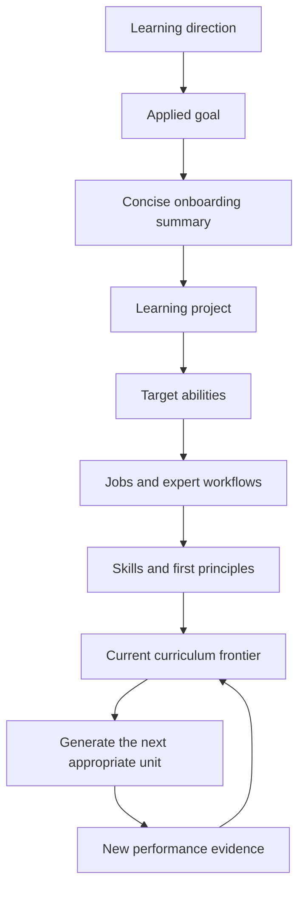
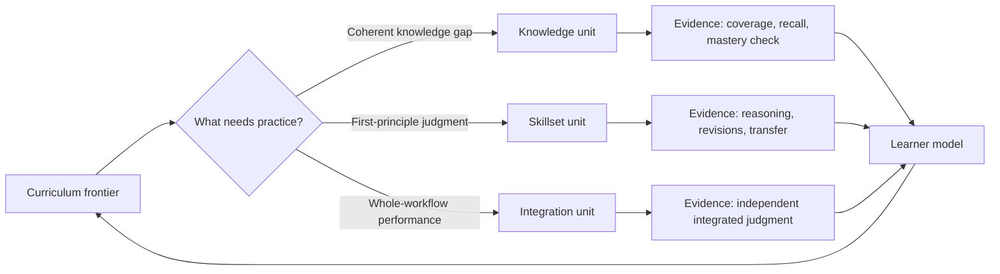
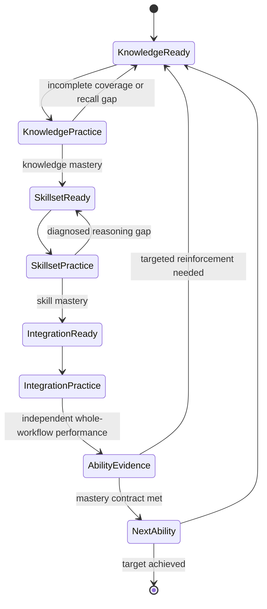

# Breakpoint: Current Learning System

Breakpoint is a chat-first learning product designed to compress expert practice: the AI carries setup, scenarios, feedback, and persistence; the learner carries framing, judgment, explanation, diagnosis, and transfer.

## 1. Curriculum and onboarding

Onboarding starts with what the learner wants to learn and what they want to do with it. The system clarifies only what the learner states, then uses that direction to form a learning project and a curriculum architecture. Curricula are organized around observable abilities, the jobs and workflows that make up those abilities, and the component skills and first principles needed to perform them.

Units are generated from the learner's current frontier rather than exhaustively authored in advance. That keeps the stable structure—the target, abilities, workflows, skills, and mastery expectations—separate from adaptive practice.

## 2. Education units

An education unit is a short, scenario-based apprenticeship loop—not a lecture or isolated quiz. It makes an important expert decision necessary under realistic pressure, observes the learner's reasoning, supplies targeted repair, and tests whether the learner can transfer the mechanism when conditions change.

The emerging modular model has three unit systems:

- **Knowledge** builds a coherent mental model of a subtopic through active reasoning, native-format checks, coverage, and recall.
- **Skillset** trains one or two first principles through repeated scenario passes, comparison with expert reasoning, and targeted revision.
- **Integration** gives the learner a messy, unlabeled whole-workflow problem with minimal support, combining already taught skills and principles.

## 3. Progression system

Progression is evidence-led, not content-led. The system decides what becomes available next, how much support to offer, and when a performance is strong enough to count as mastery. It retains evidence in a learner model, returns to decaying knowledge through recall, and raises complexity only when performance supports it.

The intended route moves from knowledge needed for a skill, to focused first-principle practice, to independent integration of the entire ability. Learners may revisit mastered material when recall or later performance reveals a gap; unsupported skills are scaffolded rather than silently graded.

### Operating principle

At every stage, Breakpoint should ask whether the learner is doing irreplaceable expert thinking. If the work is operational—setup, boilerplate, scenario state, evaluation, or artifact maintenance—the AI should carry it. If it exposes framing, tradeoffs, causal reasoning, diagnosis, revision, or transfer, the learner should carry it.
