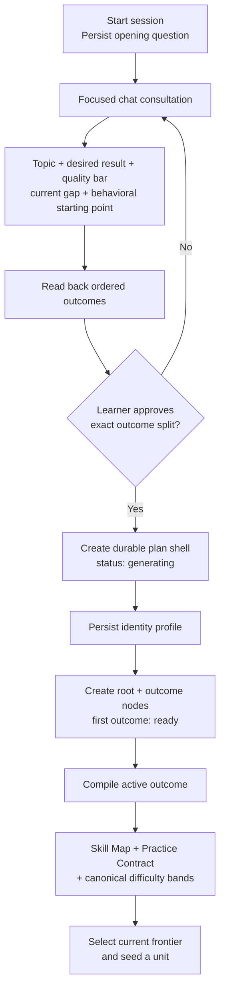
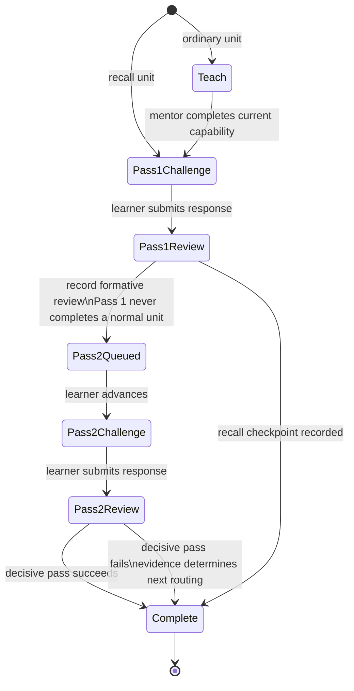
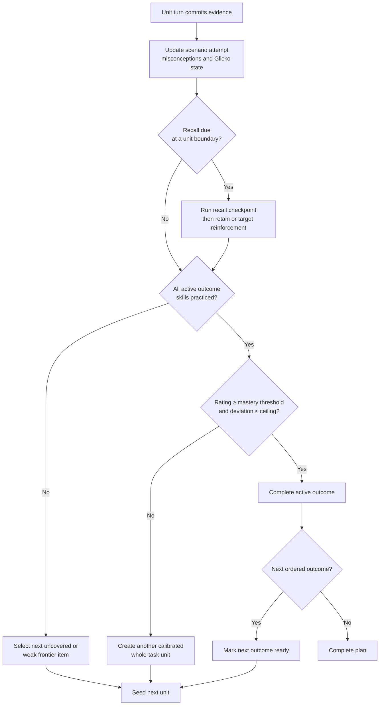

# Breakpoint — Current Learning-System Architecture

**Status:** implementation-grounded architecture note, checked against the current onboarding, outcome-curriculum, education-unit, workspace, progression, validator, and database code. This document distinguishes **implemented behavior** from the **V4 target design**; it does not treat a roadmap as production behavior.

## System thesis

Breakpoint is a chat-first system for building observable capability. It does not begin with a pre-authored course catalog. It begins with a learner-confirmed target, compiles that target into domain-authentic performance contracts, and repeatedly places the learner in work that exposes judgment rather than asking them to perform boilerplate.

The division of labor is intentional:

| Breakpoint carries | The learner carries |
| --- | --- |
| Interview structure, research, curriculum compilation, scenario authoring, state, persistence, evaluation, and difficulty selection | Goal selection, confirmation, explanation, tradeoffs, diagnosis, revision, and transfer |

The governing design check is: **does this interaction require irreplaceable expert thinking from the learner?** If not, the system should supply or automate it.

---

## 1. Curriculum and onboarding

### What is live today

Onboarding is a stateful streaming chat, not a form. `startOnboardingWorkflow` creates an onboarding session and persists the opening question: *what do you want to get good at, and what would you be able to do once you were?* The topic consultant then runs one focused question at a time. Its runtime contract requires at least three focused follow-ups in the normal case, periodic mirrors, a maximum of fifteen questions, and an explicit readback before the learner can approve a project.

The interview must establish five decision-relevant facts:

1. The topic or learning direction.
2. The concrete work, result, or use case the learner wants.
3. The quality bar and operating environment for that work.
4. The learner’s current difficulty or gap.
5. A starting-point tier grounded in concrete, domain-specific experience.

The model asks for that tier exactly once, using three or four behavioral choices rather than labels such as “beginner.” The persisted tier is one of `fundamentals`, `skip_basics`, or `advanced`; it seeds the initial Glicko rating but is not a mastery claim. The learner can correct it on the project confirmation card before the build begins.

The first durable curriculum artifact is a project shell. It captures a learner-confirmed `projectName`, target identity, one-line summary, one to ten ordered outcome definitions, starting-point rationale, and a concise system interpretation of the learner’s desired build, quality bar, and current gap. The project tool itself pauses for approval. A curriculum build cannot silently convert an ambiguous conversation into a learning plan.

### Curriculum shape and authority

The **current implemented hierarchy** is intentionally small:

```text
learning project / plan
├── root node: target identity
└── ordered outcome nodes
    └── dynamically created unit nodes
```

An outcome is the unit of curriculum commitment: a title plus a fixed, observable result that the learner has explicitly approved. The result cannot be renamed or broadened by later compilation. The first outcome is `ready`; later outcomes begin `planned` and are unlocked in order.

When an outcome becomes active, `ensureOutcomeCurriculumWorkflow` compiles two linked artifacts from the plan, identity profile, learner gap, and prior performance:

- **Skill Map** — the smallest useful capabilities that materially affect the fixed result, including concepts, executable mechanisms, expert judgments, and realistic mistakes.
- **Practice Contract** — the authentic workflow, whole task types, response format, evaluation criteria, quality bar, permissible variation axes, difficulty bands, and prohibited pseudo-tasks.

The compiler is constrained to use real domain terminology and to ensure every mapped skill appears in at least one task type and one evaluative criterion. A unit can only be constructed when its selected knowledge targets are covered by both the task contract and evaluation criteria; otherwise context construction fails instead of inventing a disconnected exercise.

The result is stable where it needs to be stable—the learner-confirmed outcome and performance contract—but adaptive at the practice level. Unit content is generated from the active frontier and prior evidence rather than being enumerated ahead of time.



### Durability, recovery, and ownership

The onboarding transcript is persisted as ordered messages. Incoming history is validated, rejects system-role messages, limits individual messages to 4,000 characters and the history to 32,000 characters, and avoids re-appending a retried final user message. Project creation has a checkpointed artifact lifecycle: `pending`, `generating`, `complete`, `generated_pending_save`, or `failed`. A renewable lease prevents concurrent builders from racing; a dropped connection can resume the same build from durable state rather than starting duplicate model work.

The build sequence is: create/name the plan shell, design and persist the curriculum, prepare the first unit, generate an optional overview, then mark the plan active and onboarding complete. The curriculum artifact is required for activation. The overview is explicitly best-effort and may be a recoverable gap without invalidating the plan.

### Current boundary versus V4 target

The current schema stores `root`, `outcome`, and `unit` nodes. The V4 design notes propose a richer generation model—topic → abilities → jobs → generalized skills → first principles → scenarios—and three specialized unit systems. That model is marked open in the repository’s V4 map and is not yet represented as the current database hierarchy or runtime dispatcher. This document uses the live outcome-based model as the source of truth for “current.”

---

## 2. Education units

### What an implemented unit is

The live education unit is a durable run state, not an ephemeral prompt. It contains an immutable snapshot of:

- the selected curriculum context: performance target, knowledge targets, workflow, expert judgments, common mistakes, tasks, variation axes, evaluation criteria, and quality bar;
- the mentor and reviewer experience instructions, including versioned customizations;
- its to-do list, current pass, current challenge, and difficulty snapshot; and
- the learner-visible transcript and the resulting evidence.

The workspace is the delivery surface. Learner-facing stage transitions appear in the continuing chat rather than in a separate “lesson player.” The server owns the state machine and completion decision; models generate mentoring, challenges, and reviews within contracts but do not independently advance the curriculum.

### The current run state machine

Every non-recall unit opens with one `capability` teaching to-do, then two scenario passes. The teaching move is deliberately small and stays on the present blocker until the learner’s reasoning is adequate. A scenario can be prepared in parallel with mentoring to avoid making the learner wait for an extra model round-trip.

Pass 1 is diagnostic and formative: its score cannot complete the unit. Pass 2 is decisive: it tests the learner after the system has seen the first attempt and can target the observed weakness. A recall run skips the teaching move and uses one decisive checkpoint that closes whether it passes or fails, so the system can route the learner to reinforcement instead of trapping them in a recall loop.



### Scenario and assessment contract

A generated challenge is not merely a question. It is constrained by the compiled outcome’s authentic response mode, task types, task variations, disallowed shortcuts, target knowledge, and explicit evaluation criteria. The active difficulty directive incorporates a rating-derived item level, support level, scenario format, and—where applicable—a targeted misconception.

The reviewer treats performance as more than answer correctness. The persisted education state has room for a response mode, confidence, server-derived latency, correctness band, misconception direction, reasoning style, diagnostic gap, concept correction, worked examples, implementation review, assessment status, score, strengths, improvements, and next step. This allows feedback to say which causal or procedural bridge failed, rather than treating every miss as the same kind of error.

Concurrency and retry behavior are part of correctness here. Each workspace turn has durable turn and unit leases. The service claims the turn before model work, heartbeats its lease while streaming, commits the resulting run atomically, and can return an already-persisted answer for a retried request. Learner timing is anchored when the server first claims the turn, not after model latency.

### Why the two-pass structure matters

One clean answer may be recognition, luck, or an answer pattern. The first pass therefore diagnoses. The second pass applies realistic pressure to the specific weak point that appeared, and only that later pass can resolve a normal unit. This is a compact approximation of deliberate practice: attempt → evidence → targeted adjustment → retest.

The system may use multiple-choice when that is the authentic or efficient format, but the contract preserves a free-response mode where the learner needs to explain, frame, or defend reasoning. It should never replace performance-revealing thinking with production work simply because production work is easy to observe.

### V4 unit-system direction

The planned V4 architecture separates responsibilities that the current generalized run shares:

| Proposed unit system | Intended mastery regime | Current implementation status |
| --- | --- | --- |
| Knowledge | Coherent subtopic understanding; coverage, mixed 90+ checks, decay, and recall | Planned; some knowledge-item and recall persistence primitives already exist |
| Skillset | One or two first principles; two scenario passes and final 90+ performance | Planned; closest conceptual successor to the current two-pass run |
| Integration | Messy, unlabeled whole-workflow work with minimal support | Planned; not a distinct live unit kind |

The V4 design requires each system to own its schemas, state machine, context budget, agents, evaluator, and evidence. Shared infrastructure may load facts and persist turns, but it must not flatten the distinct mastery rules into one generic completion flag.

---

## 3. Progression system

### What progression measures

Progression is evidence-led. It combines **breadth** (whether the relevant Skill Map has been practiced) with **depth and certainty** (whether a learner’s Glicko rating is sufficiently high and sufficiently certain for the outcome’s difficulty contract).

Each active outcome has a learner-specific `TrainingJobProgress` record containing rating, rating deviation, volatility, current band, offered support, recent attempts, and an optional mastery timestamp. Scenario attempts preserve the chosen item rating, support level, difficulty vector, targeted misconception, prompt, evaluation contract, presentation timestamps, and evaluation timestamp. Rating-prediction records preserve before/after estimates and predicted versus actual outcome. These records make later routing explainable and auditable.

The onboarding tier is only an initial prior. It moves the first challenge away from an obviously bad default; actual performance changes the rating. The system deliberately retains rating deviation because a high score with little evidence is not the same as demonstrated reliable capability.

### Live completion and unlocking rules

For an outcome that has an active Skill Map and Practice Contract, the dynamic mastery loop decides after a unit whether to create another unit or complete the outcome:

1. Count the remaining unpracticed mapped skills.
2. Compute whether the learner rating meets the outcome mastery rating, derived from the top difficulty band.
3. Require rating deviation to be at or below the practice contract’s ceiling (or the global default).
4. Complete the outcome only when **all mapped skills have been practiced** and the rating gate passes.
5. Otherwise create another unit from the frontier.

When an outcome completes, the progression engine marks it `completed`, makes the next ordered sibling `ready` when necessary, or completes the plan if none remain. It can prewarm the next outcome once at least 80% of the active outcome’s Skill Map has been covered or the rating gate already passes, reducing learner wait without prematurely unlocking it.



### Difficulty and support

Difficulty is not supposed to mean “longer prompt” or “rarer trivia.” The curriculum compiler defines legitimate difficulty bands for a fixed outcome. The runtime selects an item rating and support directive from the learner’s evidence. Increasing difficulty should add the kinds of uncertainty, tradeoffs, noise, realistic traps, and independence that change expert judgment; it should not move the learner to a different, unapproved outcome.

Support is therefore part of the measurement contract. A worked example, a guided scaffold, and an independent task do not prove the same thing. The system stores the offered support alongside attempt outcomes so its rating logic can distinguish assisted recovery from clean independent performance.

### Retention and reopening

Recall is part of progression, not a detached flashcard product. Recall gates are linked to a plan and the unit after which they may run. Recall probes record prompts, sources, responses, scores, repairs, and pass state. Each unit can also hold recall state: last recall time, ordinal position, recall count, decay count, last score, and retention status. The policy presents recall at boundaries, avoiding interruption of a partially completed reasoning loop.

The V4 direction makes this more explicit: Knowledge uses coverage and decay; Skillset uses reasoning and transfer; Integration uses independent whole-workflow performance. A later weak performance may trigger targeted reinforcement, but it must not pretend that a skill was never taught or grade an untaught, unscaffolded skill as failure.

---

## Implementation reference map

| Responsibility | Current source of truth |
| --- | --- |
| Streaming onboarding and message validation | `packages/api/src/onboarding-chat.ts` |
| Onboarding interview/tool contract | `packages/api/src/domain/training/agents/topic-onboarding-chat-agent.ts` |
| Checkpointed project build | `packages/api/src/domain/training/orchestration/build-project.ts` |
| Outcome compilation and persistence boundary | `packages/api/src/domain/training/outcome-curriculum/` |
| Unit-context projection | `packages/api/src/domain/training/unit-builder/create-unit-context.ts` |
| Durable unit to-do state machine | `packages/api/src/domain/training/education-unit/unit-state.ts` |
| Workspace turn orchestration, leases, and commits | `packages/api/src/domain/training/workspace-ai/workspace-turn-orchestration.ts` |
| Outcome mastery and node unlocking | `packages/api/src/domain/training/engine/progression-model.ts`, `plan-progression.ts` |
| Onboarding, curriculum, rating, and recall persistence | `packages/db/src/schema/training/` |
| Planned modular V4 architecture | `documentation/wayfinder/education-system-v4/map.md` |

## Non-negotiable invariants

1. Only learner-confirmed outcomes become durable curriculum commitments.
2. A model may propose content or evaluation, but the server owns state transitions, mastery decisions, and persistence.
3. A normal first-pass result cannot complete a unit; a normal unit’s second pass is decisive.
4. An outcome cannot complete on rating alone while mapped skills remain unpracticed.
5. A high rating alone is insufficient while rating uncertainty exceeds the allowed ceiling.
6. Retrieval or reinforcement occurs at a unit boundary, not by abandoning an unfinished reasoning loop.
7. The system must persist enough context and evidence to resume safely after a disconnect or retried request.
8. Operational work belongs to the AI; the learner’s time is reserved for expert judgment.
