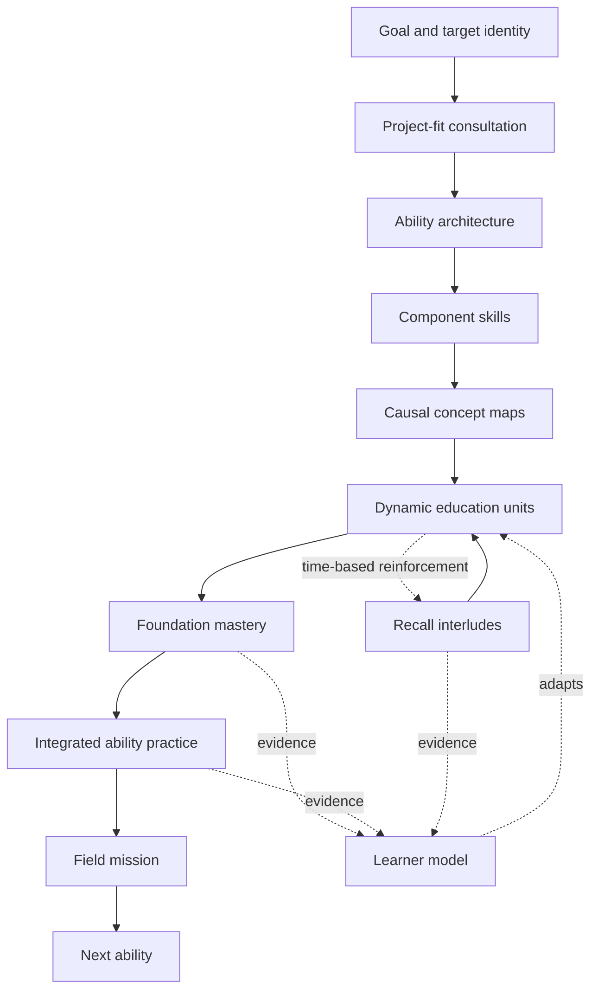

# Breakpoint Education System V3

## Purpose

Breakpoint is a chat-first AI education system for building real capability, not delivering a catalog of lessons. It begins with the person the learner wants to become, maps the work that identity must perform, and turns that work into adaptive practice that asks the learner to make expert decisions under realistic pressure.

The central design question is:

> How can a chat-first AI system use an adaptive curriculum to make a person perform beyond expert level in a domain, faster than normal apprenticeship?

V3 is organized around one answer: compress the structure of expert practice without removing the thinking that makes the practice valuable. The AI carries setup, scaffolding, scenario generation, evaluation, and persistence. The learner carries framing, judgment, causal explanation, diagnosis, revision, and transfer.

This document describes the current canonical education model. The document version is V3; individual runtime recipes and internal data structures may retain names such as `education-unit-v2` because those names pin live learner runs to a stable implementation.

## The System at a Glance



The system has five connected layers:

1. **Identity and goal formation** — determine who the learner wants to become and what they want to be able to do.
2. **Curriculum architecture** — decompose that target performance into abilities, skills, workflows, causal concepts, and mastery contracts.
3. **Education units** — run short, evolving scenario loops that teach, expose reasoning, repair errors, and test transfer.
4. **Progression and calibration** — decide what opens next, how much support to provide, and whether the evidence is strong enough to count as mastery.
5. **Retention and real-world proof** — revisit decaying knowledge through recall and require field missions when an integrated ability is ready to be completed.

## The Core Division of Labor

Breakpoint is designed around cognitive leverage. The learner should never be forced to do operational work merely to prove they are participating.

| The AI carries                               | The learner carries                     |
| -------------------------------------------- | --------------------------------------- |
| Project and curriculum scaffolding           | Choosing a meaningful direction         |
| Research and workflow mapping                | Clarifying goals and constraints        |
| Scenario authoring and state                 | Framing the situation                   |
| Boilerplate, examples, and drafts            | Making decisions and tradeoffs          |
| Evaluation and feedback generation           | Explaining causal reasoning             |
| Progress, evidence, and artifact persistence | Diagnosing and revising mistakes        |
| Difficulty and support calibration           | Transferring judgment to a changed case |

This is the practical test for every learning interaction:

> Is the learner doing the irreplaceable expert thinking, or are we making them do low-value production work?

## 1. From Goal to Learning Project

### Project-fit consultation

The learner does not begin by selecting a generic topic from a course catalog. Breakpoint begins with a short consultation about the learner's desired identity, motivation, current behavior, constraints, and sources of fascination in the field.

The onboarding conversation is intentionally compact. It asks one question at a time, establishes a concrete behavioral starting point, and gathers named products, companies, systems, creators, or projects that genuinely interest the learner. These interests later become scenario fuel; they are not decorative profile data.

The system then proposes a small set of project directions judged by:

- personal interest;
- usefulness;
- technical or professional depth;
- ability to teach the field;
- quality of the eventual demonstration; and
- likelihood that the learner will persist.

Nothing is provisioned until the learner chooses and confirms a project.

### Starting-point calibration

The learner describes their starting point through concrete behaviors, not labels such as “beginner” or “advanced.” Internally, that signal becomes a deliberately uncertain rating seed. It shifts the initial estimate enough to avoid obviously misplaced work while preserving enough uncertainty for the system to probe and correct the estimate from performance.

The current seeds are:

| Starting-point signal | Initial rating | Initial uncertainty |
| --------------------- | -------------: | ------------------: |
| Fundamentals          |            950 |                ±250 |
| Skip basics           |           1150 |                ±250 |
| Advanced              |           1350 |                ±250 |

These values are routing inputs, not learner-facing ranks or claims of mastery.

### Durable project artifacts

Once confirmed, the project build produces and persists:

- an identity report;
- a before-and-after performance profile;
- the curriculum architecture;
- the initial learner calibration;
- a project overview; and
- the first runnable curriculum frontier.

The curriculum is required for the project to become active. Supporting artifacts can be resumed or regenerated without discarding completed work.

## 2. Curriculum Architecture

### The hierarchy

New Breakpoint curricula use this structure:

```text
target identity
└── ability
    ├── skill
    │   ├── causal concept map
    │   └── dynamically created foundation units
    ├── skill
    │   ├── causal concept map
    │   └── dynamically created foundation units
    └── dynamically created skillset units
        └── field mission before ability completion
```

The curriculum designer creates two to six main abilities. Each ability is a whole, observable performance that a practitioner can be visibly good or bad at—for example, “architect backend systems under real constraints”—rather than a subject label such as “databases.”

Each ability contains:

- an integrated workflow of three to seven ordered reasoning and action steps;
- a difficulty ramp for whole-ability practice;
- observable exit criteria; and
- three to eight component skills in dependency order.

A skill represents a recurring **signal moment** inside the ability workflow: a moment where expert judgment produces a meaningfully different outcome from novice behavior. Routine activity that does not discriminate expertise is excluded.

### From skills to causal concept maps

Each skill receives a concept map of six to twenty-four ordered entries. These entries are not topic labels. Each is a falsifiable causal mechanism of the form:

> X, under condition Y, causes Z.

For example:

- Weak: “idempotency.”
- Strong: “Retrying a non-idempotent write after a timeout can execute the side effect twice because the first attempt may have succeeded before the timeout fired.”

Concept entries may be discriminations, causal models, compact subskills, or necessary vocabulary. The map is ordered by dependency and judgment difficulty, with particular weight given to distinctions and failure modes that experts recognize and novices collapse together.

This mechanism-first format matters because it makes each concept directly usable as a scenario template. The unit generator does not need to invent a lesson from a topic label; it can construct a situation in which the causal claim becomes load-bearing.

### Units are generated from the frontier, not authored up front

The curriculum designer deliberately does **not** enumerate education units. Units are created just in time from the learner's current progression state.

When Breakpoint needs the next unit, it:

1. finds the next uncovered concepts in the active skill;
2. selects a small frontier, normally up to two concepts;
3. reads the learner's prior attempts and recurring failures;
4. resolves the appropriate difficulty and support directive;
5. creates a unit whose scenario makes those concepts necessary; and
6. persists the unit so the live chat can resume reliably.

This keeps the curriculum stable at the level that should be stable—identity, abilities, workflows, skills, and mastery contracts—while allowing the actual practice to respond to evidence.

## 3. The Education Unit

An education unit is the core unit of practice. It is not a miniature lecture or an isolated concept quiz. It is a short apprenticeship loop built around one evolving scenario.

### Canonical V3 experience

The current runtime recipe contains three rounds:

```text
Orient
  ↓
Connect 1 ↔ guided retry
  ↓
Solve 1   ↔ repair
  ↓
Teach + evolve scenario
  ↓
Connect 2 ↔ guided retry
  ↓
Solve 2   ↔ repair
  ↓
Teach + evolve and mutate scenario
  ↓
Connect 3 ↔ guided retry
  ↓
Solve 3   ↔ repair
  ↓
Mastered
```

The learner remains inside one chat session. Stage changes appear as natural chat progression rather than separate tools or modes.

### Orient: build a usable model

Orient gives the learner a concise map of the skill and one expert trip through it. It connects the skill to the larger system it belongs to, introduces vocabulary only when it names something already made concrete, and exposes what an expert notices, infers, chooses, and verifies.

The goal is not content coverage. The goal is a model the learner can mentally run before entering the scenario.

### Connect: reconstruct the causal problem

Connect presents a scenario authored backward from the reasoning Breakpoint wants to test. The system defines the causal chasm first, then constructs a minimal world in which crossing that chasm is necessary.

The scenario contains:

- **State A** — the current imperfect reality;
- **State B** — the desired outcome;
- **the chasm** — the causal claim or cognitive leap required to move between them;
- **friction and noise** — the realistic pressure that makes the mechanism fail;
- a private canonical answer and reasoning path; and
- a grading rubric.

The learner must reconstruct who wants what, how the current mechanism works, and why it fails under the new pressure. If the connection is incomplete, Breakpoint asks pointed questions rather than handing over the answer.

Connect does not fail the learner out. After two unsuccessful graded connections, the system escalates help by teaching the missed idea and re-posing the same causal problem. The learner continues until the connection is real.

### Solve: produce and defend the response

Once the learner understands the problem, Solve asks them to frame the solution. The evaluator scores the reasoning, not merely the final answer. A correct answer reached through a shortcut or memorized procedure does not demonstrate full mastery.

The server—not the model—owns the unit verdict. The model reports a score from 0 to 100; the runtime derives a pass at 80 or above. A failed Solve remains in Solve with feedback as a repair map. After repeated failed repairs, the next turn includes a short worked micro-teach anchored to the learner's own attempt, followed by another learner attempt.

### Teach: diagnose, repair, and evolve

Between rounds, Teach reconstructs the learner's approach across the transcript and explains the root model behind visible mistakes. It contrasts the learner model with the expert model, replays the work as an expert example, and makes every missing causal bridge explicit.

Teach then evolves the same scenario. The actors, stakes, and world persist, while a new complication makes the corrected mechanism matter in a harder form. The final round also mutates a load-bearing constraint so that repeating the earlier procedure is insufficient. The learner must re-derive the answer from the mechanism.

This combination provides continuity without sacrificing transfer:

- **same world** creates ownership and lowers reorientation cost;
- **escalating friction** increases judgment demand; and
- **final constraint mutation** distinguishes understanding from memorization.

### What a unit actually measures

A unit produces evidence about whether the learner can:

- identify the real goal and mechanism in a noisy situation;
- explain the causal failure;
- choose and justify a response;
- repair a flawed mental model;
- perform with reduced support; and
- transfer the mechanism when a core constraint changes.

Completion alone is not the evidence. The learner's decisions, explanations, errors, repairs, timing, support use, and transfer performance are the evidence.

## 4. Progression: Two Mastery Regimes

Breakpoint separates **foundation mastery** from **integrated ability performance**. Treating both as the same numerical climb would make early and late concepts unfairly dependent on when they were learned.

| Regime     | Curriculum owner | What it trains                                  | Mastery evidence                                           | Writes ability rating? |
| ---------- | ---------------- | ----------------------------------------------- | ---------------------------------------------------------- | ---------------------- |
| Foundation | Skill            | Component causal mechanisms and discriminations | Every concept repeatedly survives scored use               | No                     |
| Skillset   | Ability          | Integrated workflow under increasing ambiguity  | Rating, low uncertainty, and clean low-support performance | Yes                    |

### Foundation progression: criterion-referenced coverage

Foundation units are created beneath a skill. Each scored final-round solve may check off only the target concepts the learner directly demonstrated.

A concept must be load-bearing in three qualifying solves before it reaches the coverage target. A skill becomes mastered only when every concept in its map reaches that target. An empty concept map can never count as mastery because missing curriculum data is not learner success.

Foundation units still receive calibrated scenario difficulty, but that difficulty never gates mastery and never changes the ability rating. This produces an important fairness invariant:

> A causal concept learned twentieth is judged by the same criterion as a causal concept learned first.

If the map is not covered, Breakpoint creates another unit from the remaining frontier. When the skill is mastered, the next sibling skill opens. When all skills under an ability are mastered, the ability changes from the `foundations` stage to the `skillset` stage.

### Skillset progression: integrated performance

Skillset units are created directly beneath an ability. They require the learner to perform the whole workflow rather than rehearse one component skill.

Ability performance uses a Glicko-2 style estimate with three values:

- **rating** — the current estimate of performance;
- **rating deviation** — how uncertain that estimate remains; and
- **volatility** — how quickly the estimate appears to change.

The ability is ready to complete when the learner reaches the ability's peak rating and the deviation is within the mastery contract, currently ±80 by default. Until then, Breakpoint creates further integrated units rather than advancing on a fixed lesson count.

### Goldilocks difficulty and support

The language model does not choose difficulty on its own. A deterministic decision ladder reads the rating state, recent attempts, difficulty bands, support use, timing, and active misconceptions, then issues a scenario directive.

The ladder prioritizes:

1. **Repair** an active misconception before increasing difficulty.
2. **Probe** when uncertainty is too high to calibrate a useful challenge.
3. **Back off** after consecutive hard failures, increasing support before lowering the band.
4. **Promote** after clean, unsupported evidence near the current band ceiling.
5. **Fade support** after repeated success at the current support level.
6. **Challenge** at the current level, targeting roughly a 70% expected success point.

Support moves through:

```text
worked example → guided → none
```

Difficulty and support are independent. Breakpoint can hold task difficulty steady while fading scaffolding, or raise support without pretending the learner's capability has fallen.

### Evidence quality affects calibration

The rating engine learns from four low-friction signals:

- the rubric score;
- the evaluator's closed error code;
- side-chat use during the attempt; and
- whether the learner exceeded the time budget.

An assisted or over-time high score can still pass the unit, but it is discounted as rating evidence and may not count as a clean unsupported pass. This prevents help-seeking or slow completion from being misrepresented as independent mastery while keeping help available.

Misconceptions are durable states rather than disposable feedback text. A recurring error becomes active, a clean targeted repair moves it to addressed, and a second clean targeted repair resolves it. If it reappears, it becomes active again.

## 5. Curriculum Advancement

Curriculum nodes use simple lifecycle statuses:

- `planned` — visible in the plan but not yet runnable;
- `ready` — the current runnable frontier; and
- `completed` — the node's mastery contract has been satisfied.

Abilities also carry a separate executable stage:

- `foundations` — child skills are being mastered;
- `skillset` — integrated ability units are open; and
- `mastered` — the ability and its required proof are complete.

Status answers “is this part of the active plan?” Stage answers “what kind of work may run beneath this ability?” Keeping them separate prevents an active ability from accidentally skipping its foundations.

The canonical advancement sequence is:

```text
master current skill
  → open next skill
  → repeat until every skill is mastered
  → open ability skillset units
  → reach ability mastery threshold
  → complete field mission
  → open next ability's first skill
  → repeat until the plan is complete
```

The plan therefore expands from evidence. It is not a static checklist whose length is mistaken for rigor.

## 6. Recall and Retention

Breakpoint treats recall as part of progression, not a separate study mode. A recall interlude can appear only at a unit boundary, so the learner is never pulled out of an unfinished reasoning loop.

Every mastered concept begins a reinforcement clock. The current spacing ladder is:

```text
3 days → 7 days → 21 days → 60-day maintenance
```

When a concept becomes due, the most overdue eligible concept becomes the primary recall target. When possible, Breakpoint composes it with a strong, non-due companion concept from the same skill. This reflects the view that forgetting in a connected domain is often a loss of relationships, not merely loss of isolated facts.

Recall skips the teaching and Connect phases. It begins directly with a fresh scored transfer scenario in Solve. A pass increases the concept's strength and widens the next interval. A failure reduces strength by one step and brings the concept back sooner without erasing all prior evidence.

## 7. Field Missions

Education units test compressed judgment inside Breakpoint. Field missions test whether an integrated ability can survive contact with a small real-world action.

When an ability has reached its internal mastery threshold, the learner must complete a mission before the ability can be marked complete. The mission flow is:

```text
shape → choose → commit → prove → debrief
```

Breakpoint asks a short adaptive question, proposes exactly three tailored missions, and turns the chosen mission into a plan of no more than three steps. Missions are intentionally bounded—roughly five to sixty minutes—and ask for concise proof rather than a giant artifact.

Submitted proof is evaluated across:

- **execution** — did the learner substantially perform the action? (40 points)
- **evidence** — is the proof concrete and credible? (35 points)
- **judgment** — does the work show the decisions or understanding being trained? (25 points)

The normal passing standard is 70. After four guided attempts, a growth pass is possible at 55 or above when the learner has improved by at least 10 points from the first attempt and provides evidence across all three dimensions. This preserves a real standard while recognizing demonstrated apprenticeship growth.

## 8. The Learner Model and Durable Evidence

Breakpoint stores more than chat text. The durable education state includes:

- the identity profile and before/after target;
- the curriculum tree and current frontier;
- ability stages and node statuses;
- concept coverage, check-off evidence, and recall strength;
- the active unit recipe, phase, round, and retry counters;
- the current scenario specification and frozen difficulty directive;
- phase responses, scores, error codes, and timing;
- per-ability ratings, uncertainty, support level, and attempt history;
- misconception states;
- prediction logs comparing expected and actual performance; and
- mission plans, proof, evaluations, and debriefs.

This state allows a unit, recall interlude, or mission to resume without asking the model to reconstruct truth from an unbounded transcript. It also makes the system auditable: Breakpoint can inspect why a difficulty decision was made, what evidence changed a rating, and whether its predicted success rates match real outcomes.

## 9. The Chat-First Learner Experience

The canonical learner surface is the workspace. The curriculum appears as a navigable plan, but all active learning progresses through one chat-first experience.

The workspace is responsible for:

- showing the current scenario and its stakes;
- streaming teaching and evaluation rather than making the learner wait for a full completion;
- preserving submitted answers and feedback as readable exchanges;
- exposing status such as preparing, thinking, evaluating, and saving;
- allowing bounded coaching questions without moving the learner into another product; and
- resuming the exact durable phase after interruption.

The learner should feel that they are working with one adaptive coach, even though specialized agents handle scenario design, teaching, evaluation, curriculum design, recall, and mission assessment behind the interface.

## 10. System Invariants

These rules define the education system more strongly than any particular UI or prompt:

1. **Start from desired performance, not topic coverage.**
2. **Model expert jobs and workflows before decomposing knowledge.**
3. **Keep only decision moments where expertise changes the outcome.**
4. **Represent concepts as causal mechanisms, not chapter labels.**
5. **Generate units from the live mastery frontier rather than fixing them all in advance.**
6. **Keep the learner responsible for judgment and the AI responsible for operational load.**
7. **Use realistic pressure without requiring huge manual artifacts.**
8. **Repair until understanding is demonstrated; do not force-advance after failure.**
9. **Require transfer by changing a load-bearing constraint.**
10. **Separate foundation coverage from integrated ability rating.**
11. **Fade support before raising difficulty, and repair misconceptions before optimizing challenge.**
12. **Treat completion as workflow state and performance evidence as the basis of mastery.**
13. **Reinforce decaying knowledge at unit boundaries.**
14. **Require concise real-world proof before completing an ability.**
15. **Keep every adaptive decision inspectable and recoverable from durable state.**

## 11. What Success Means

Breakpoint does not define success as consuming content, finishing a fixed number of lessons, or producing a large artifact. A successful learner increasingly demonstrates that they can:

- recognize the important signal in an unfamiliar situation;
- reconstruct the causal mechanism behind the situation;
- select an appropriate strategy under constraints;
- explain tradeoffs and likely failure modes;
- diagnose and repair their own model;
- perform with less support and greater time discipline;
- transfer the skill when the surface and constraints change; and
- produce credible evidence of the integrated ability in the world.

That is the education system's governing promise: not merely to help someone know more, but to make expert-quality performance visible, repeatable, transferable, and durable.

## Implementation Reference

The primary implementation sources for this document are:

- [Curriculum contracts](../packages/api/src/domain/training/agents/contracts.ts)
- [Curriculum designer](../packages/api/src/domain/training/agents/curriculum-designer.ts)
- [Curriculum tree builder](../packages/api/src/domain/training/orchestration/curriculum-flow.ts)
- [Concept-map designer](../packages/api/src/domain/training/agents/syllabus-designer.ts)
- [Dynamic unit creation](../packages/api/src/domain/training/unit-creation/create-next-unit.ts)
- [Education-unit recipe](../packages/api/src/domain/training/education-unit/unit.ts)
- [Education-unit state machine](../packages/api/src/domain/training/education-unit/fsm.ts)
- [Scenario specification](../packages/api/src/domain/training/education-unit/scenario-spec.ts)
- [Progression model](../packages/api/src/domain/training/engine/progression-model.ts)
- [Progression decisions](../packages/api/src/domain/training/engine/plan-progression.ts)
- [Goldilocks decision ladder](../packages/api/src/domain/training/engine/rating/decide.ts)
- [Concept coverage](../packages/api/src/domain/training/engine/concept-coverage.ts)
- [Recall policy](../packages/api/src/domain/training/policies/recall-decay.ts)
- [Mission evaluation policy](../packages/api/src/domain/training/missions/mission-evaluation-policy.ts)
